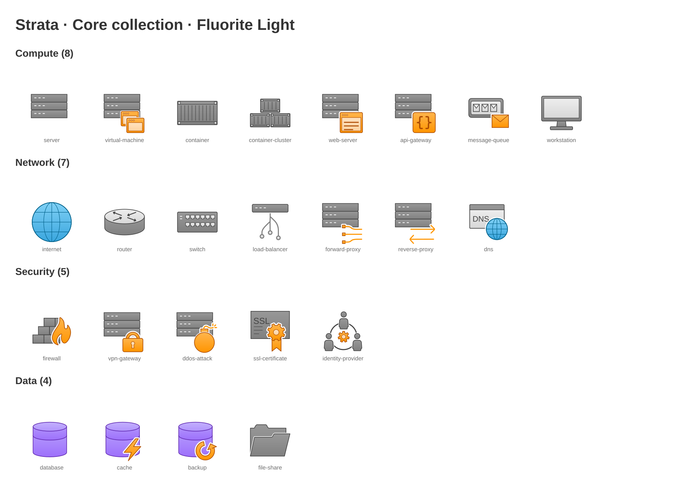

# Strata

**IT architecture icons for system diagrams.** Filled, layered icons in a light and a dark theme, coloured with the [Fluorite palette](#colours), as SVG, PNG and Visio stencils.

Strata is organised in collections. The core collection holds vendor-neutral icons, and platform collections hold the icons for one platform. Every collection is drawn from the same building blocks and palette, so icons from different collections line up and match in one diagram.

<picture>
  <source media="(prefers-color-scheme: dark)" srcset="collections/core/preview/preview-dark.svg">
  
</picture>

## Collections

| Collection | Icons | Covers |
| --- | --- | --- |
| [Core](collections/core/) | 24 icons | Vendor-neutral IT: servers, virtual machines, containers, web servers, API gateways, message queues and workstations; the internet, routers, switches, load balancers, proxies and DNS; firewalls, VPN gateways, certificates and identity providers; databases, caches, backups and file shares. A starting set, to be extended |
| [ArcGIS](collections/arcgis/) | 122 icons, plus 10 containers and labels | ArcGIS Enterprise components, data stores, apps and user types. It also includes general IT components (firewall, DNS, load balancer, proxies, file share, certificates), user personas, data types and charts, and network containers that suit any system diagram. Adapted from Esri's ArcGIS Architecture Diagramming Toolkit |

**Overlap.** Nine general IT icons, such as Firewall, DNS and Load Balancer, are in both the core and the ArcGIS collection. The drawings and file names are the same, so either copy works. The ArcGIS collection keeps them so that it stays a complete match for Esri's toolkit. New vendor-neutral icons are added to the core collection only.

## Themes

Every icon comes in two themes:

- **Fluorite Light**, for white and light backgrounds.
- **Fluorite Dark**, for dark backgrounds such as `#1e2329`.

The fills are the same in both themes. In Dark, text tags and free-standing lines are lightened so they stay readable.

## Formats

Each collection has these folders. The ArcGIS collection also has `alternates/`, with alternate versions of some icons.

| Folder | Contents |
| --- | --- |
| `svg/` | Four files per icon: `name.svg` (Light) `name_dark.svg` (Dark) `name_painted-gap.svg` (Light, painted gaps) `name_dark_painted-gap.svg` (Dark, painted gaps) Containers and labels have only the Light and Dark files, since they have no gaps |
| `png/` | PNG files in `64/` and `256/`, aligned to the pixel grid for crisp edges. Icons are 64 or 256 px wide; icons with a vendor tag are taller. Containers and labels keep their own proportions, at the same scale |
| `manifest.json` | Every icon with its group, shape name, source, and SVG, PNG and Visio files |
| `visio/` | Visio stencils, one per group of icons, in Light and in Dark |
| `preview/` | Preview sheets of every icon, in Light and Dark, as SVG (sharp at any size) and PNG |

## Using the icons

- **Diagram tools:** drag SVGs into draw.io (diagrams.net), Figma, Inkscape, Illustrator, PowerPoint or Keynote, or use the PNGs anywhere.
- **Overlapping parts:** where one part of an icon sits in front of another, there is a small gap around it. In `name.svg` the gaps are transparent, so they show whatever is behind the icon. Some tools can't show transparent gaps. In those tools, use the `_painted-gap` files on a matching background (white for Light, `#1e2329` for Dark), or use the PNGs.
- **Recolouring:** the parts are grouped and named, so you can select and recolour them in an editor.
- **Visio:** open a stencil with *More Shapes* > *Open Stencil*. The parts use Visio gradient fills; readers without gradient support, such as LibreOffice, show each part in the gradient's top colour.
- **Captions:** names such as *Web Adaptor* are not part of the SVG and PNG icons. Add them in your diagram tool; Arial 10 pt below the icon works well. The Visio shapes include their captions.
- **Spacing:** every icon sits on a 76 × 76 canvas with 2 units of padding, so icons line up when placed side by side. Icons with a vendor tag above them, such as *Oracle* or *Amazon S3*, are taller. The tag sits above the canvas, and the icon itself still lines up with the others.

## Colours

The colours come from Fluorite, a palette published separately as [Fluorite Palette](https://github.com/bixb0012/fluorite-palette):

- Servers are blue, data stores violet, apps red-orange, general items teal, IT charcoal and people green.
- Role badges are always amber, and variant markers are always gold.

## License and attribution

Strata is copyright © 2026 Strata contributors and licensed under the [Creative Commons Attribution 4.0 International license (CC BY 4.0)](LICENSE). You may use, share and adapt it, including commercially, as long as you give credit. Some icons are adapted from other people's work. Each collection's `NOTICE.md` names its sources and gives the credit to use:

- **Core:** [Strata icons](https://github.com/bixb0012/strata-architecture-icons), core collection, [CC BY 4.0](https://creativecommons.org/licenses/by/4.0/). Includes material adapted from the ArcGIS Architecture Diagramming Toolkit by Esri (CC BY 4.0). Not affiliated with or endorsed by Esri.
- **ArcGIS:** [Strata icons](https://github.com/bixb0012/strata-architecture-icons), ArcGIS collection, [CC BY 4.0](https://creativecommons.org/licenses/by/4.0/). Adapted from the ArcGIS Architecture Diagramming Toolkit by Esri (CC BY 4.0). Not affiliated with or endorsed by Esri.

For diagrams, a short credit in a caption, footnote or slide notes is enough. Where links can't be followed, as in print, write the addresses out.

Product names on the icons are trademarks of their owners. They are used only to describe what each icon represents. CC BY 4.0 does not grant trademark rights. This summary is not legal advice.
