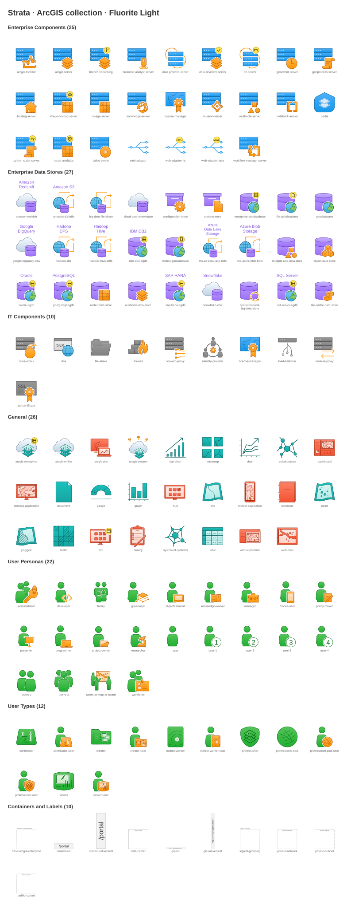

# Strata: ArcGIS collection

Icons for diagramming ArcGIS systems, together with the general IT components, people and network containers that appear around them. The collection is adapted from Esri's [ArcGIS Architecture Diagramming Toolkit](https://architecture.arcgis.com/en/framework/architecture-practices/diagramming-resources.html) (version 1.2, December 19, 2024). It keeps Esri's shapes and redraws them as filled, layered icons in Fluorite Light and Fluorite Dark.

> This collection is not affiliated with, sponsored by or endorsed by Esri. ArcGIS and the product names on these icons are trademarks of their owners. They are used only to describe what each icon represents.

<picture>
  <source media="(prefers-color-scheme: dark)" srcset="preview/preview-dark.svg">
  
</picture>

To compare the themes, open the [switchable preview](https://raw.githubusercontent.com/bixb0012/strata-architecture-icons/main/collections/arcgis/preview/preview.svg). It opens in your system theme and has a Light / Dark switch.

## What's included

**122 icons**, plus **10 containers and labels**, in seven groups that match Esri's seven stencils. License Manager is in two groups, as in Esri's toolkit, so there are 121 different drawings:

| Group | Icons | Notes |
| --- | --- | --- |
| Enterprise Components | 25 | ArcGIS Enterprise servers and components |
| Enterprise Data Stores | 27 | Data stores, geodatabases, cloud data warehouses, file shares |
| IT Components | 10 | General IT: firewall, DNS, load balancer, proxies, file share, certificates. All but License Manager are also in the [core collection](../core/) |
| General | 26 | ArcGIS apps and clouds, plus general data types, charts and networks |
| User Personas | 22 | General people and roles |
| User Types | 12 | ArcGIS user types |
| Containers and Labels | 10 | Network containers and URL labels |

The folders:

| Folder | Contents |
| --- | --- |
| `svg/<group>/` | The icons as SVG, in Light and Dark, each with transparent or painted gaps |
| `png/64/<group>/`, `png/256/<group>/` | PNG files |
| `visio/` | One Visio stencil per group, in Light and in Dark |
| `alternates/` | The alternate sets (see below) |
| `preview/` | Preview sheets |
| `manifest.json` | Every icon and container with its group, Esri shape name, and SVG, PNG, Visio and alternate files |

File names follow Esri's shape names, in lowercase and hyphenated. For example, *ArcGIS Server* is `svg/enterprise-components/arcgis-server.svg`. Where Esri's names are abbreviated or misspelled, the file name spells them out: *Workflow Mgr Server* is `workflow-manager-server.svg`.

**Visio:** the stencils keep Esri's shape names, connection points and caption positions. You can use *Replace Shape* to swap Esri's shapes for these in an existing diagram. The containers are real, resizable Visio containers.

## Alternate sets

`alternates/variant-e/` and `alternates/variant-em/` hold alternate versions of some icons, as SVG and PNG. They use the same file names as the main set, so you can swap any icon for its alternate.

**Variant E (21 icons)** follows Esri's design decisions in Strata's style:

- There are no variant chips.
- Esri's inside text appears as labels on the rack units.
- The Web Adaptor variants and the Azure file shares carry Esri's wording as tags.
- Icons that Esri draws identically, such as ETL Server and Data Process Server, are identical again.
- The geodatabases show the globe behind a small cylinder, as Esri draws them.

**Variant EM (9 icons)** shows the geodatabases in Esri's composition, with Strata's variant chips.

## How this collection differs from Esri's toolkit

| | Esri's toolkit | Strata ArcGIS collection |
| --- | --- | --- |
| Formats | Visio stencils (.vssx), which can also be imported into Lucidchart and draw.io | Visio stencils (.vssx), SVG and PNG |
| Drawing style | Outline icons, one line colour per stencil | Filled, layered parts in three tones: a body, pale inner panels and dark outlines |
| What colour means | Mostly which stencil an icon came from | What a component is: servers are blue, data stores violet, apps red-orange, general items teal, IT charcoal and people green. Role badges are always amber, and variant markers are always gold |
| Backgrounds | Esri recommends a white or light background | A light theme and a dark theme |
| Look-alike icons | Several icons are identical drawings told apart only by their labels: Data Process and ETL Server, Geoprocess and Python Script Server, ArcGIS Online and ArcGIS Enterprise, Hub and Site, and Geodatabase, File Geodatabase and Enterprise Geodatabase | Each icon can be told apart without its label. A small gold *variant chip* marks variants, such as ETL, Py, a server for Enterprise, a page for File or a browser window for Site |
| Overlaps | Where one object overlaps another, the one behind is cut away | Objects are drawn whole, with a clean gap where one sits in front of another. Racks, cylinders and people have the same size and position in every icon |

### Why

- **Faster reading in large diagrams.** When colour shows what kind of component something is, and roles always use the same colour, a busy architecture is quicker to scan.
- **Dark slides and dark-mode documents.** Esri's line icons are designed for light backgrounds.
- **No ambiguous pairs.** Two icons that look the same should not mean different things.

### When to use Esri's icons instead

Esri asks that its icons be used as provided, without changing their colours. If you need the official Esri look, use Esri's toolkit from the [ArcGIS Architecture Center](https://architecture.arcgis.com/en/framework/architecture-practices/diagramming-resources.html). That applies to material published by or with Esri, and to contributions to the ArcGIS Architecture Center. This collection is a separate, unofficial set for everyone else.

## Attribution

See [NOTICE.md](NOTICE.md) for the attribution, the changes from Esri's original, and trademarks.
