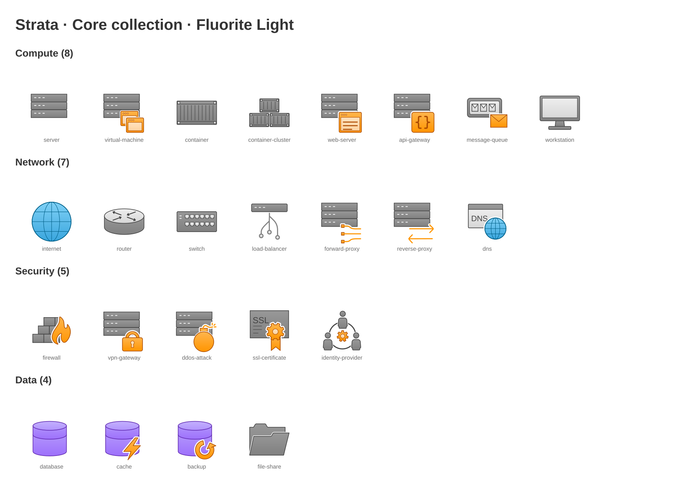

# Strata: core collection

Vendor-neutral icons for IT architecture diagrams: servers, virtual machines and containers, networks, security and data. Use them on their own, or beside a platform collection such as [ArcGIS](../arcgis/).

The core collection is a starting set, not a complete library. More icons will be added over time.

<picture>
  <source media="(prefers-color-scheme: dark)" srcset="preview/preview-dark.svg">
  
</picture>

To compare the themes, open the [switchable preview](https://raw.githubusercontent.com/bixb0012/strata-architecture-icons/main/collections/core/preview/preview.svg). It opens in your system theme and has a Light / Dark switch.

## What's included

**24 icons** in four groups:

| Group | Icons |
| --- | --- |
| Compute (8) | Server, Virtual Machine, Container, Container Cluster, Web Server, API Gateway, Message Queue, Workstation |
| Network (7) | Internet, Router, Switch, Load Balancer\*, Forward Proxy\*, Reverse Proxy\*, DNS\* |
| Security (5) | Firewall\*, VPN Gateway, DDoS Attack\*, SSL Certificate\*, Identity Provider\* |
| Data (4) | Database, Cache, Backup, File Share\* |

\* Also in the ArcGIS collection, where it is part of the IT Components group. The drawing is the same in both collections, and so is the file name. Only the description inside the file names its collection, so you can use either copy.

The folders:

| Folder | Contents |
| --- | --- |
| `svg/<group>/` | The icons as SVG, in Light and Dark, each with transparent or painted gaps |
| `png/64/<group>/`, `png/256/<group>/` | PNG files |
| `visio/` | One Visio stencil per group, in Light and in Dark |
| `preview/` | Preview sheets |
| `manifest.json` | Every icon with its group, shape name, source, and SVG, PNG and Visio files |

## Colours

The core collection follows the same colour rules as the rest of Strata:

- **Infrastructure is charcoal.** That covers servers, virtual machines, containers, network devices and gateways. Blue is kept for application servers, such as ArcGIS Server in the ArcGIS collection.
- **Data stores are violet.**
- **Role badges are amber.** A badge shows what a component does, such as a lock on a VPN gateway or a lightning bolt on a cache.
- **The internet globe** keeps its natural colours.

## Using the icons with other collections

Every collection uses the same canvas, line weights, building blocks and anchoring. A core Server, a core Web Server and an ArcGIS Server line up with each other when placed side by side, so you can mix collections in one diagram.

**Visio:** open a stencil with *More Shapes* > *Open Stencil*. The shapes shared with the ArcGIS collection keep Esri's shape names and connection points. The new shapes have eight connection points round the icon and a caption below it.

## Attribution

See [NOTICE.md](NOTICE.md).
